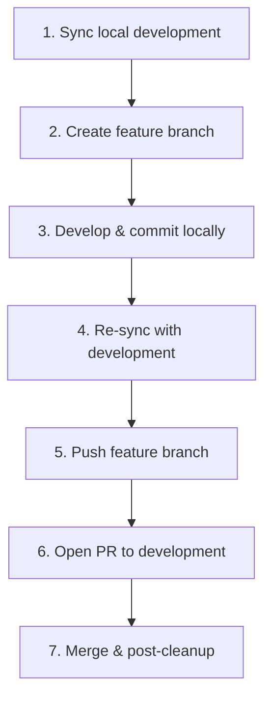

# WASLA (`وَصْلَة`) — Git & Feature Development Workflow Guide

This document defines the standard, end-to-end Git workflow and commit conventions for engineers working across all 5 tracks (.NET Backend, Web, Mobile, AI, and Data) in the WASLA polyglot monorepo.

---

## 1. Branch Hierarchy & Purpose

```text
  [main]            <-- Production / Stable milestone releases (Protected)
    ^
    |  (Release PR at end of sprint / milestone)
  [development]     <-- Main integration branch for all ongoing active work
    ^
    |  (Feature PR via GitHub PR Template)
  [feat/<track>/...] <-- Ephemeral working branches (Created by developers)
```

- **`main`**: Reflects verified, working code. Protected branch. Merges only come from `development` via verified milestone PRs.
- **`development`**: The shared source of truth during development sprints. All feature branches fork from and merge back into `development`.
- **Feature Branches (`feat/...`, `fix/...`, `refactor/...`)**: Temporary branches created by individual contributors for specific capabilities, sub-tasks, or bug fixes.

---

## 2. Branch Naming Conventions

Always use lowercase, kebab-case, and prefix with the track and ticket/capability ID:

| Type | Pattern | Examples |
| :--- | :--- | :--- |
| **Feature** | `feat/<track>/<id>-<description>` | `feat/backend/c1-tenant-filter`<br>`feat/web/c7-kanban-board`<br>`feat/mobile/c15-notifications-ui` |
| **Sub-Task** | `feat/<track>/sub-<id>-<description>` | `feat/backend/sub-12-dto-validation`<br>`feat/data/sub-04-kpi-sql-views` |
| **Bug Fix** | `fix/<track>/<id>-<description>` | `fix/web/rtl-table-overflow`<br>`fix/backend/auth-token-expiry` |
| **Refactoring** | `refactor/<track>/<description>` | `refactor/ai/vector-indexer-modularization` |
| **Contracts** | `contract/<scope>-<description>` | `contract/openapi-projects-v1`<br>`contract/events-kpi-catalog` |
| **Documentation** | `docs/<area>/<id>-<description>` | `docs/srs/03-rbac-permission-matrix`<br>`docs/adr/adr-006-web-framework` |

> Documentation-only changes follow the [WASLA Documentation Standards (`WASLA-DS-001`)](../standards/documentation-standards.md). Code changes that affect documented behavior update the docs in the **same** branch — do not open a separate `docs/...` branch for them.

---

## 3. Commit Message Conventions (Conventional Commits)

All commits in WASLA must adhere strictly to the **Conventional Commits** specification. This ensures automated changelog generation, clean git history, and immediate traceability for code reviews.

### 3.1 Standard Structure

```text
<type>(<scope>): <imperative subject line>

[optional body explaining WHAT and WHY, not HOW]

[optional footer: e.g., Closes #123, Breaking Changes]
```

### 3.2 Commit Types

| Type | Purpose | Example |
| :--- | :--- | :--- |
| **`feat`** | New feature or capability implementation | `feat(backend): add tenant resolution middleware` |
| **`fix`** | Bug fix or defect remediation | `fix(web): resolve Arabic RTL table header misalignment` |
| **`contract`** | Canonical contract update (`/contracts`) | `contract(state-machines): add REWORK_REQUESTED transition` |
| **`refactor`** | Code refactoring with no behavior or API changes | `refactor(ai): modularize vector indexing pipeline` |
| **`test`** | Adding new tests or fixing existing tests | `test(backend): add tenant isolation integration tests` |
| **`docs`** | Documentation additions or updates | `docs(adr): add ADR-006 for realtime notification strategy` |
| **`infra`** | Docker Compose, migrations, or local dev tooling | `infra(docker): configure pgvector extension in postgres` |
| **`ci`** | GitHub Actions, workflows, or PR/Issue templates | `ci(github): add sub-task and bug report issue templates` |
| **`chore`** | Routine maintenance, dependency updates, repo setup | `chore(deps): update EntityFrameworkCore to latest patch` |
| **`perf`** | Performance optimization | `perf(data): optimize KPI K3 aggregate query indexing` |

### 3.3 Scope Guidelines

Use scopes that reflect the track or functional domain:

- **Track Scopes**: `backend`, `web`, `mobile`, `ai`, `data`
- **Domain Scopes**: `auth`, `tenancy`, `challenges`, `projects`, `kanban`, `rubric`, `portfolio`, `matching`, `audit`, `notifications`
- **Infrastructure / Cross-cutting Scopes**: `docker`, `github`, `deps`, `i18n`, `contracts`
- **Documentation Scopes** (with `docs` type): `vision`, `srs`, `adr`, `specs`, `operations`, `onboarding`, `pilot`, `plan`, `standards`, `template`, or a track scope for a track `README.md`

### 3.4 Formatting Rules

1. **Imperative Mood**: Use imperative verbs (*"add"*, *"fix"*, *"implement"*, *"refactor"* — not *"added"*, *"fixes"*, *"implementing"*).
2. **Subject Casing**: Lowercase immediately following the colon (e.g., `feat(auth): add...`, not `feat(auth): Add...`).
3. **No Trailing Period**: Do not end the subject line with a period.
4. **Subject Length**: Keep under **72 characters** so GitHub and terminal logs render cleanly without truncation.
5. **Body Explains *Why***: Use the commit body to explain the context and architectural reasoning, not code mechanics.

### 3.5 Good vs. Bad Commit Examples

| Good Commit Message | Bad Commit Message | Reason |
| :--- | :--- | :--- |
| `feat(backend): implement tenant filter middleware` | `Added middleware` | Missing type, scope, and uses past tense |
| `fix(web): prevent RTL layout overflow in project cards` | `fixed bug in navbar` | Missing conventional type, vague description |
| `contract(openapi): define challenge submission v1 schema` | `update json` | Untraceable, misses SSoT contract significance |
| `test(tenancy): add cross-tenant query leak tests` | `test` | Meaningless subject line |
| `infra(docker): expose mailpit web UI on port 8025` | `docker stuff` | Unprofessional and lacks context |

---

## 4. The 7-Step Feature Lifecycle



### Step 1: Pre-Flight & Sync Local `development`
Before starting any new work, ensure your local `development` branch matches `origin/development`:

```bash
# Switch to development
git checkout development

# Fetch and pull latest changes
git pull origin development
```

### Step 2: Create a Dedicated Feature Branch
Fork directly from the up-to-date `development` branch:

```bash
# Format: git checkout -b feat/<track>/<issue-id>-<description>
git checkout -b feat/backend/c1-tenant-filter
```

### Step 3: Implement, Test & Commit Incrementally
Follow Conventional Commits standards. Keep commits cohesive, atomic, and buildable:

```bash
# Check modified files
git status

# Stage specific changes
git add src/backend/Middleware/TenantFilterMiddleware.cs

# Commit with a clear Conventional Commit message
git commit -m "feat(backend): implement tenant filter middleware for request context"
```

*Before pushing, always run local validations (e.g. unit tests, JSON contract check):*
```bash
# Example: validate contracts if touched
python -c "import glob, json; [json.load(open(p, 'r', encoding='utf-8')) for p in glob.glob('contracts/**/*.json', recursive=True)]; print('Contracts valid!')"
```

### Step 4: Re-Sync with `development` Before Pushing
Other team members may have merged PRs into `development` while you were coding. Incorporate their updates to avoid surprises:

```bash
# Fetch latest remote changes
git fetch origin

# Rebase your commits on top of the latest development
git rebase origin/development
```
*(If conflicts arise, resolve them, `git add <resolved-file>`, and run `git rebase --continue`).*

### Step 5: Push Feature Branch to Remote
Push your branch to GitHub and set upstream tracking:

```bash
git push -u origin feat/backend/c1-tenant-filter
```

### Step 6: Open Pull Request on GitHub
1. Go to the repository on GitHub.
2. Click **Compare & pull request**.
3. **Ensure Base is `development`** (`base: development` $\leftarrow$ `compare: feat/...`).
4. Fill out the PR using the repository's [`.github/PULL_REQUEST_TEMPLATE.md`](../../.github/PULL_REQUEST_TEMPLATE.md):
   - Set title (e.g. `feat(backend): add multi-tenant filter middleware`).
   - Add `Closes #<issue-number>` in the **Related Issues** section.
   - Complete the **WASLA-VN-001 NFR Checklist** (`tenant_id` isolation, RTL, audit logs, tests).
5. Request review from track code owners (per [`.github/CODEOWNERS`](../../.github/CODEOWNERS)).

### Step 7: Post-Merge Local Cleanup
Once the PR is approved, CI passes, and the PR is merged into `development`:

```bash
# Switch back to development
git checkout development

# Pull the newly merged changes
git pull origin development

# Delete the local feature branch
git branch -d feat/backend/c1-tenant-filter

# Prune remote tracking references
git fetch origin --prune
```

---

## 5. Real-World Scenarios

### Scenario A: Standard Feature Implementation
*Goal*: You are assigned sub-task issue `#25` to add the C1 tenant context accessor in .NET.

```bash
# 1. Update development
git checkout development
git pull origin development

# 2. Branch
git checkout -b feat/backend/sub-25-tenant-context-accessor

# 3. Code, test, and commit
git add src/backend/Context/TenantContext.cs
git commit -m "feat(backend): add ITenantContext accessor and DI registration"

git add src/backend/Tests/TenantContextTests.cs
git commit -m "test(backend): add unit tests for ITenantContext resolution"

# 4. Push
git push -u origin feat/backend/sub-25-tenant-context-accessor

# 5. Open PR -> Target: development, Link: Closes #25
# 6. After PR merge on GitHub:
git checkout development
git pull origin development
git branch -d feat/backend/sub-25-tenant-context-accessor
```

---

### Scenario B: Another Developer Merged Ahead of You (Rebasing)
*Goal*: While you were working on `feat/web/c7-kanban`, your teammate merged an API client update into `development`. You want to pull in their updates cleanly.

```bash
# 1. Commit all your local uncommitted work first
git add .
git commit -m "feat(web): add kanban card drag handler"

# 2. Fetch latest changes from remote
git fetch origin

# 3. Rebase your branch on top of updated origin/development
git rebase origin/development

# 4. If there are no conflicts: Git reapplies your commits at the tip.
# 5. Force-with-lease push your rebased branch (only if you already pushed previously)
git push --force-with-lease origin feat/web/c7-kanban
```

---

### Scenario C: Handling a Merge Conflict During Rebase
*Goal*: A conflict occurs in `src/web/components/Navbar.tsx` while rebasing on `development`.

```bash
git fetch origin
git rebase origin/development
# Output: CONFLICT (content): Merge conflict in src/web/components/Navbar.tsx

# 1. Open the conflicted file in VS Code / Antigravity IDE
# 2. Look for conflict markers:
#    <<<<<<< HEAD (incoming from development)
#    =======
#    >>>>>>> your commit
# 3. Resolve the conflict by keeping the correct combination.

# 4. Mark the conflict as resolved
git add src/web/components/Navbar.tsx

# 5. Continue rebasing (DO NOT RUN git commit!)
git rebase --continue

# 6. Once rebasing completes successfully:
git push --force-with-lease origin feat/web/c7-kanban
```

---

### Scenario D: Promoting `development` to `main` (Sprint / Milestone Release)
*Goal*: At the end of a sprint (e.g. Milestone M1 / Week 45), all tested features on `development` are promoted to production on `main`.

```text
[Flow]:
1. Verify CI on development is green.
2. Open a Pull Request on GitHub:
   - Base branch: main
   - Compare branch: development
   - Title: release: deploy Milestone 1 (M1) foundation & discovery
3. Review PR diff and merge via GitHub (Merge commit or Fast-forward).
4. Tag the release on main:
   git checkout main
   git pull origin main
   git tag -a v0.1.0-m1 -m "Milestone 1 Release"
   git push origin v0.1.0-m1
5. Sync development back with main if release commits were added:
   git checkout development
   git pull origin development
```

---

## 6. Golden Rules for Monorepo Contributors

1. **Never commit directly to `main` or `development`**: Always work in a feature branch.
2. **Never change `/contracts` without an RFC / Issue**: Contracts are the cross-track Single Source of Truth.
3. **Keep branches short-lived**: Branches lasting $>3$ days risk heavy merge conflicts. Merge sub-tasks frequently.
4. **Always link issues in PRs**: Use `Closes #123` so GitHub issues close automatically when PRs merge.
5. **Never force-push (`git push --force`) to shared branches**: Only `--force-with-lease` on your private feature branch when rebasing.
