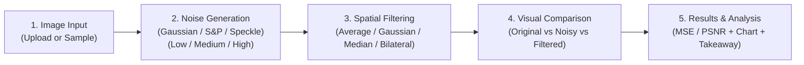

# Execution Plan — Image Noise Removal Laboratory

> **Branch:** `docs/plan/01-execution-plan` (follows `docs/<area>/<id>-<description>` from [branch-name-convention.md](../branch-name-convention.md))  
> **Project Type:** Classical Image Processing Academic Application (Python + Streamlit)  
> **Core Principle:** Simplest, cleanest, beginner-friendly implementation that satisfies **all** mandatory academic requirements with a modern dark-themed UI—no Machine Learning, no Deep Learning, and no overengineering.

---

## 1. Architecture & Modular Design

The project uses a flat, easy-to-navigate modular layout with simple Python functions (no unnecessary classes, databases, or APIs):

```text
Image_Noise_Removal/
├── .streamlit/
│   └── config.toml          # Modern dark theme configuration
├── assets/
│   └── styles.css           # Subtle dark-UI styling (cards, borders, spacing)
├── docs/
│   └── EXECUTION_PLAN.md    # This execution plan
├── sample_images/           # 5–8 small clean reference images from Kaggle dataset
├── src/
│   ├── __init__.py          # Marks src/ as a Python package
│   ├── image_utils.py       # Image upload validation, loading, RGB/BGR helpers
│   ├── noise.py             # Gaussian, Salt-and-Pepper, and Speckle noise (NumPy)
│   ├── filters.py           # Average, Gaussian, Median, and Bilateral filters (OpenCV)
│   ├── metrics.py           # MSE, PSNR, and best-filter recommendation logic
│   └── visualization.py     # Simple Matplotlib bar chart for filter comparison
├── app.py                   # Main Streamlit application (Sidebar + 4 pages)
├── requirements.txt         # Minimal pinned dependencies
└── README.md                # Setup, dataset instructions, and run guide
```

### Application Flow



### UI Navigation Structure (4 Clean Pages)

1. **Dashboard** — Welcome header, project overview, supported noise/filter summary cards, and quick-start instructions.
2. **Noise Laboratory** — Unified interactive workspace: upload/select clean image → add noise (type + Low/Medium/High intensity) → apply a spatial filter (with kernel parameter) → view 3-way side-by-side comparison & summary.
3. **Filter Comparison** — Applies all 4 filters to the current noisy image simultaneously, displays a clean comparison grid, MSE/PSNR metrics table, Matplotlib PSNR bar chart, and an automatic explanation of which filter performed best and why.
4. **About Project** — Concise academic reference explaining the 3 noise models, 4 spatial filters, MSE/PSNR metrics, and dataset usage (ideal for professor Q&A).

---

## 2. Technology Stack & Dependencies

| Library | Package Name | Why It Is Used (Beginner-Friendly) |
| :--- | :--- | :--- |
| **Python** | Python 3.10+ | Core programming language for the project. |
| **NumPy** | `numpy` | Represents images as 2D/3D numeric arrays; used to generate Gaussian, Salt-and-Pepper, and Speckle noise and calculate MSE/PSNR. |
| **OpenCV** | `opencv-python` | Industry-standard classical image processing library; provides fast built-in spatial filters (`blur`, `GaussianBlur`, `medianBlur`, `bilateralFilter`). |
| **Pillow** | `Pillow` | Safely opens and validates uploaded image files (`.jpg`, `.jpeg`, `.png`) and handles format/RGB conversion before passing to NumPy. |
| **Streamlit** | `streamlit` | Turns pure Python scripts into an interactive, modern dark-themed web application with zero HTML/JS boilerplate. |
| **Matplotlib** | `matplotlib` | Draws a clean, dark-themed bar chart comparing filter PSNR scores in the Filter Comparison workspace. |

---

## 3. Proposed Additional Spatial Filter ("Other Filters" Requirement)

To satisfy the academic requirement of **"other filters"** without adding complexity, we include **one** classical spatial filter alongside the three mandatory ones:

- **Bilateral Filter (`cv2.bilateralFilter`)**
  - **Why this filter?** It is a single built-in OpenCV function and a classic spatial filter known for **edge-preserving smoothing**.
  - **Academic value:** While Average and Gaussian filters blur edges along with noise, the Bilateral Filter weights neighboring pixels by both spatial distance *and* intensity similarity—meaning it smooths flat noisy regions while keeping sharp object boundaries intact. This creates a great talking point during your academic defense.

---

## 4. Dataset Analysis & Usage Strategy

**Reference Dataset:** [Kaggle — Image Denoising with GANs](https://www.kaggle.com/competitions/image-denoising-with-ga-ns/data)

### Dataset Structure
Competitions of this type are structured for supervised/GAN image denoising and typically include:
- **`train/` (clean / ground-truth & noisy folders):** Paired clean reference images and their synthetically noisy counterparts.
- **`test/`:** Unseen noisy images intended for competition scoring.
- **`*.csv` / `sample_submission.csv`:** Metadata and competition submission templates (not needed for our classical filtering project).

### Recommended Simplest Strategy
1. **Do NOT download or process the full dataset** — large image collections are meant for training neural networks, not classical spatial filtering experiments.
2. **Use a small subset of 5–8 clean reference images** from the dataset's clean/ground-truth folder, saved in `sample_images/`. Choose images with diverse visual traits:
   - Sharp edges / geometric shapes (shows edge-blurring vs. edge-preserving filters).
   - Fine textures / details (shows detail loss at larger kernel sizes).
   - Smooth gradients / backgrounds (clearly reveals Gaussian and Speckle noise).
3. **Generate noise dynamically in the app:** Starting from clean reference images (either from `sample_images/` or user-uploaded JPG/PNG files) allows us to apply Gaussian, Salt-and-Pepper, and Speckle noise at **Low**, **Medium**, and **High** intensities on demand—while always retaining the exact clean ground truth for accurate visual comparison and MSE/PSNR evaluation.

---

## 5. Phase-by-Phase Execution Plan

Each phase is small, self-contained, independently runnable, and testable before moving to the next.

---

### Phase 0: Project Analysis, Dataset Subset & Environment Setup

1. **Objective:** Prepare the local Python virtual environment, install dependencies, configure `.gitignore`, and prepare a small set of clean sample images for development and testing.
2. **Tasks:**
   - Verify Python 3.10+ is installed locally.
   - Create and activate a Python virtual environment (`.venv`).
   - Create `requirements.txt` with the 5 core libraries (`streamlit`, `opencv-python`, `numpy`, `Pillow`, `matplotlib`).
   - Install all dependencies via `pip`.
   - Create a `.gitignore` file (ignoring `.venv/`, `__pycache__/`, `.DS_Store`, etc.).
   - Create the `sample_images/` folder and place 5–8 clean reference images (from the Kaggle dataset clean subset) inside it.
3. **Files:**
   - `[NEW] requirements.txt`
   - `[NEW] .gitignore`
   - `[NEW] sample_images/` (folder with 5–8 clean `.png`/`.jpg` reference images)
4. **Libraries:** `streamlit`, `opencv-python`, `numpy`, `Pillow`, `matplotlib`.
5. **Expected Output:** A clean, isolated Python environment where all required libraries import without errors, and a ready-to-use folder of clean reference images.
6. **Testing:**
   - Run a one-line Python import check verifying `cv2`, `numpy`, `PIL`, `streamlit`, and `matplotlib` load cleanly.
   - Confirm `sample_images/` contains 5–8 valid `.jpg`/`.png` files.
7. **Acceptance Criteria:**
   - Virtual environment activates cleanly.
   - All 5 libraries import with zero errors.
   - `sample_images/` is populated and lightweight.
8. **Estimated Difficulty:** **Easy**

---

### Phase 1: Project Structure & Modern Dark UI Shell

1. **Objective:** Create the folder skeleton, configure Streamlit's modern dark theme and subtle custom CSS, and build the 4-page sidebar navigation shell with a polished Dashboard and About page.
2. **Tasks:**
   - Create the `src/` package directory (`src/__init__.py`).
   - Configure `.streamlit/config.toml` with a cohesive modern dark palette (deep slate background, elevated card surfaces, crisp accent color, clean sans-serif font).
   - Create `assets/styles.css` for rounded cards, subtle borders, clean section headers, and spacing.
   - Build `app.py` with:
     - Sidebar branding (`Image Noise Removal Lab`) and navigation radio/menu: **Dashboard**, **Noise Laboratory**, **Filter Comparison**, **About Project**.
     - Complete **Dashboard** page (welcome banner, project overview, 3-step quick-start guide, overview cards of noise types and filters).
     - Placeholder sections for **Noise Laboratory** and **Filter Comparison**.
     - Initial **About Project** page with clear academic overview.
3. **Files:**
   - `[NEW] .streamlit/config.toml`
   - `[NEW] assets/styles.css`
   - `[NEW] src/__init__.py`
   - `[NEW] app.py`
4. **Libraries:** `streamlit`.
5. **Expected Output:** Running `streamlit run app.py` launches a polished, modern dark-themed dashboard with working sidebar navigation across all 4 pages.
6. **Testing:**
   - Run `streamlit run app.py`.
   - Click through all 4 sidebar pages and confirm smooth navigation, dark theme styling, and zero console/UI errors.
7. **Acceptance Criteria:**
   - Dark theme and rounded card styling render cleanly without layout overlap.
   - All 4 pages are accessible via the sidebar.
   - No runtime warnings or errors in the terminal.
8. **Estimated Difficulty:** **Easy**

---

### Phase 2: Image Upload, Sample Selection & Validation

1. **Objective:** Enable users to upload clean images (JPG, JPEG, PNG) or pick from `sample_images/`, validate files gracefully, and display the original image with basic metadata (dimensions, channels, format).
2. **Tasks:**
   - Implement `src/image_utils.py` with simple, well-documented helper functions:
     - `load_and_validate_image(uploaded_file)` — validates extension/integrity using Pillow, converts to standard 3-channel RGB NumPy `uint8` array, handles corrupted/unsupported files cleanly.
     - `list_sample_images(folder)` & `load_sample_image(path)` — loads clean reference images from `sample_images/`.
     - `get_image_info(image)` — returns width, height, and color mode for display.
     - `resize_for_display(image, max_width)` — keeps UI previews crisp and dimensionally consistent.
   - Connect image input to the **Noise Laboratory** page in `app.py` using `st.session_state` so the active image persists across pages and interactions.
   - Display clear, friendly error messages when an invalid or corrupted file is uploaded.
3. **Files:**
   - `[NEW] src/image_utils.py`
   - `[MODIFY] app.py`
4. **Libraries:** `Pillow`, `numpy`, `streamlit`.
5. **Expected Output:** Users can upload a JPG/PNG image or pick a sample image, see the original image preview with its resolution, and see a graceful error message if an invalid file is uploaded.
6. **Testing:**
   - Upload a valid `.jpg` and `.png` image → verify both display correctly.
   - Select a sample image from `sample_images/` → verify it loads immediately.
   - Attempt to upload an invalid/corrupted file (e.g., renamed `.txt` file as `.jpg`) → verify the app shows a friendly error message and does not crash.
7. **Acceptance Criteria:**
   - FR1 (Image Input) is fully satisfied.
   - Valid images render cleanly in RGB (no swapped red/blue channels).
   - Invalid files are caught gracefully without stack traces.
8. **Estimated Difficulty:** **Easy**

---

### Phase 3: Noise Generation Algorithms

1. **Objective:** Implement Gaussian, Salt-and-Pepper, and Speckle noise using simple NumPy operations with Low, Medium, and High intensity presets, and display the noisy image next to the original image.
2. **Tasks:**
   - Implement `src/noise.py` with clear, beginner-friendly functions:
     - Intensity preset dictionary (`LOW`, `MEDIUM`, `HIGH`) mapping each noise type to well-calibrated numeric parameters (e.g., Gaussian `sigma`: 15 / 35 / 60; Salt-and-Pepper `amount`: 0.02 / 0.06 / 0.15; Speckle `variance/sigma`: 0.15 / 0.35 / 0.60).
     - `add_gaussian_noise(image, intensity)` — adds zero-mean Gaussian noise and clips to `[0, 255]`.
     - `add_salt_and_pepper_noise(image, intensity)` — randomly sets equal fractions of pixels to `255` (salt) and `0` (pepper).
     - `add_speckle_noise(image, intensity)` — applies multiplicative noise `img + img * normal(0, sigma)` and clips to `[0, 255]`.
     - `apply_noise(image, noise_type, intensity)` — clean dispatcher function.
   - Update the **Noise Laboratory** page in `app.py`:
     - Noise type selector (Gaussian, Salt-and-Pepper, Speckle).
     - Intensity level selector (Low, Medium, High) showing the exact parameter value used.
     - **Apply Noise** button that stores the noisy image and settings in `st.session_state`.
     - Side-by-side preview of **Original Image** and **Noisy Image**.
3. **Files:**
   - `[NEW] src/noise.py`
   - `[MODIFY] app.py`
4. **Libraries:** `numpy`, `streamlit`.
5. **Expected Output:** Users can generate all 3 noise types at Low, Medium, and High intensities and visually inspect the Original vs. Noisy image side by side.
6. **Testing:**
   - Test all 9 combinations (3 noise types × 3 intensity levels) on a clean image.
   - Verify visual accuracy:
     - Gaussian shows uniform grain across the image.
     - Salt-and-Pepper shows sharp white (`255`) and black (`0`) dots.
     - Speckle shows grainy multiplicative distortion stronger in brighter regions.
   - Verify output arrays remain valid `uint8` with values in `[0, 255]` and identical dimensions to the original image.
7. **Acceptance Criteria:**
   - FR2 (Noise Generation) is fully satisfied.
   - Intensity progression (Low < Medium < High) is visibly distinct for all 3 noise types.
   - Changing the source image cleanly resets stale noisy results.
8. **Estimated Difficulty:** **Medium**

---

### Phase 4: Spatial Filtering Algorithms

1. **Objective:** Implement Average, Gaussian, Median, and Bilateral spatial filters using OpenCV built-in functions with beginner-friendly parameter controls, and integrate the Filtering Workspace into the Noise Laboratory.
2. **Tasks:**
   - Implement `src/filters.py` using OpenCV built-ins:
     - `apply_average_filter(image, kernel_size)` → `cv2.blur`
     - `apply_gaussian_filter(image, kernel_size, sigma)` → `cv2.GaussianBlur`
     - `apply_median_filter(image, kernel_size)` → `cv2.medianBlur`
     - `apply_bilateral_filter(image, diameter, sigma_color, sigma_space)` → `cv2.bilateralFilter`
     - `apply_filter(image, filter_name, params)` — clean dispatcher function enforcing valid odd kernel sizes (`3, 5, 7, 9`).
   - Update **Noise Laboratory** in `app.py` with the Filtering section:
     - Filter selector (Average, Gaussian, Median, Bilateral).
     - Context-sensitive basic parameter controls (e.g., Kernel Size slider `3, 5, 7, 9` for Average/Gaussian/Median; simple diameter/sigma controls for Bilateral).
     - **Apply Filter** button that stores the filtered image and parameters in `st.session_state`.
     - Filtered image preview.
3. **Files:**
   - `[NEW] src/filters.py`
   - `[MODIFY] app.py`
4. **Libraries:** `opencv-python`, `numpy`, `streamlit`.
5. **Expected Output:** Users can select any of the 4 filters, tune its basic parameter, click Apply Filter, and immediately see the denoised output.
6. **Testing:**
   - Apply all 4 filters to a noisy image across kernel sizes `3, 5, 7, 9`.
   - Confirm Median Filter dramatically cleans Salt-and-Pepper noise.
   - Confirm Gaussian and Bilateral Filters smooth Gaussian noise, with Bilateral preserving sharper edges.
   - Verify no crashes when switching filters or adjusting parameters.
7. **Acceptance Criteria:**
   - FR3 (Image Filtering) is fully satisfied.
   - All 4 filters use OpenCV built-in functions and preserve image shape and `uint8` RGB format.
   - Kernel size is always guaranteed to be a valid odd integer ≥ 3.
8. **Estimated Difficulty:** **Medium**

---

### Phase 5: Image Comparison & Quality Metrics (MSE / PSNR)

1. **Objective:** Build the 3-way visual comparison workspace (Original vs. Noisy vs. Filtered) with consistent dimensions, clear labels, and simple MSE/PSNR quality metrics so users can quantitatively verify denoising improvement.
2. **Tasks:**
   - Implement `src/metrics.py` using pure NumPy:
     - `calculate_mse(original, processed)` — Mean Squared Error between two images.
     - `calculate_psnr(original, processed)` — Peak Signal-to-Noise Ratio in dB (handling identical images gracefully as `∞`).
     - `get_experiment_summary(...)` — produces a clean, readable summary of noise type, intensity, filter applied, parameters, Noisy PSNR vs. Filtered PSNR, and improvement delta (`+X.XX dB`).
   - Build the **Comparison Workspace** section in `app.py`:
     - Clean 3-column comparison grid: **Original Image**, **Noisy Image**, **Filtered Image** with identical display sizing and clear captions.
     - Metric cards showing Noisy PSNR, Filtered PSNR, and PSNR Improvement.
     - Simple Results Summary card explaining the current experiment settings and outcome.
3. **Files:**
   - `[NEW] src/metrics.py`
   - `[MODIFY] app.py`
4. **Libraries:** `numpy`, `streamlit`.
5. **Expected Output:** A crisp 3-column visual comparison with aligned image dimensions, PSNR metrics, and an easy-to-read experiment summary.
6. **Testing:**
   - Run an experiment (e.g., Salt-and-Pepper Medium + Median Filter `k=3`).
   - Verify Original, Noisy, and Filtered images align horizontally with clear labels.
   - Verify Filtered PSNR is higher than Noisy PSNR (positive improvement delta) and MSE decreases.
7. **Acceptance Criteria:**
   - FR4 (Image Comparison) and core FR5 (Results Summary) are satisfied.
   - Images maintain consistent dimensions across all 3 columns.
   - Metrics compute accurately without divide-by-zero errors.
8. **Estimated Difficulty:** **Easy**

---

### Phase 6: Filter Comparison Workspace, Chart Visualization & Analysis

1. **Objective:** Build the dedicated **Filter Comparison** page that runs all 4 spatial filters on the current noisy image simultaneously, displays a visual comparison grid, plots a Matplotlib PSNR comparison bar chart, and explains which filter works best for each noise type.
2. **Tasks:**
   - Implement `src/visualization.py` using Matplotlib:
     - `plot_psnr_comparison(results_dict, noisy_psnr)` — clean, dark-themed horizontal or vertical bar chart comparing PSNR (dB) of all 4 filters against the noisy baseline.
   - Extend `src/metrics.py` with:
     - `evaluate_all_filters(original, noisy, kernel_size)` — runs Average, Gaussian, Median, and Bilateral filters and returns filtered images, MSE, and PSNR for each.
     - `get_noise_filter_insight(noise_type, best_filter)` — beginner-friendly academic explanation of *why* the winning filter works best for that noise type.
   - Complete the **Filter Comparison** page in `app.py`:
     - Prompt user gently if no noisy image has been created yet (with a quick fallback option or instruction).
     - Unified kernel size control to compare all filters fairly.
     - Visual grid showing Original, Noisy, and all 4 Filtered images.
     - Clean metrics summary table (Filter, MSE, PSNR, Gain vs. Noisy) highlighting the best performer.
     - Matplotlib PSNR bar chart + academic takeaway box.
3. **Files:**
   - `[NEW] src/visualization.py`
   - `[MODIFY] src/metrics.py`
   - `[MODIFY] app.py`
4. **Libraries:** `matplotlib`, `opencv-python`, `numpy`, `streamlit`.
5. **Expected Output:** One-click comparison of all 4 spatial filters on the current noisy image, complete with visual grid, metrics table, dark-themed PSNR chart, and clear academic takeaway.
6. **Testing:**
   - Test Filter Comparison on all 3 noise types:
     - **Salt-and-Pepper:** Confirm **Median Filter** achieves the highest PSNR and visually cleanest result.
     - **Gaussian Noise:** Confirm **Gaussian / Bilateral Filter** outperforms Average/Median at preserving quality.
     - **Speckle Noise:** Confirm all 4 filters render, metrics update accurately, and chart displays cleanly without overlapping labels.
7. **Acceptance Criteria:**
   - FR5 (Results & Analysis) and FR6 (Visualization) are fully satisfied.
   - Chart matches the app's dark theme and is legible at standard screen widths.
   - Best-filter recommendation accurately matches the highest PSNR result.
8. **Estimated Difficulty:** **Medium**

---

### Phase 7: Integration, Edge-Case Testing, Final Polish & README

1. **Objective:** Polish UI/UX consistency, test edge cases across the entire workflow, finalize the About Project documentation page, and write a clear `README.md` for installation, execution, and academic presentation.
2. **Tasks:**
   - End-to-end walkthrough of all 4 pages to verify smooth state transitions (e.g., uploading a new image resets old noisy/filtered outputs cleanly).
   - Edge-case checks:
     - Grayscale input images (1-channel) and PNGs with transparency (4-channel RGBA) converted cleanly to 3-channel RGB.
     - Very small or very large uploaded images handled gracefully without breaking layout or slowing down.
     - Clicking "Filter Comparison" before generating noise displays a helpful guide instead of an error.
   - Finalize the **About Project** page with clear, student-friendly explanations of all noise models, filters, and PSNR.
   - Write a comprehensive, concise `README.md` covering:
     - Project overview & features.
     - Folder structure.
     - Installation & virtual environment steps.
     - Dataset subset setup instructions.
     - How to run (`streamlit run app.py`).
     - Summary table of noise types vs. best spatial filters.
3. **Files:**
   - `[NEW] README.md`
   - `[MODIFY] app.py` (minor UI polish & edge-case guards)
   - `[MODIFY] src/image_utils.py` (if any grayscale/RGBA edge cases need tightening)
   - `[MODIFY] assets/styles.css` (final visual polish)
4. **Libraries:** All project libraries (`streamlit`, `opencv-python`, `numpy`, `Pillow`, `matplotlib`).
5. **Expected Output:** A complete, bug-free, demo-ready Image Noise Removal Laboratory application with clean source code and full documentation.
6. **Testing:**
   - Fresh-start test: launch `streamlit run app.py` and walk through Dashboard → Noise Laboratory (upload + sample, all 3 noises, all 4 filters) → Filter Comparison → About Project.
   - Test grayscale image, RGBA PNG, and invalid file upload.
   - Verify `README.md` commands work verbatim on a clean terminal.
7. **Acceptance Criteria:**
   - All 6 Functional Requirements (FR1–FR6) and all 9 Final Deliverables are verified complete.
   - Zero crashes, zero uncaught exceptions, and clean dark-themed UI throughout.
   - Code is readable, well-commented, and easy to explain to a professor.
8. **Estimated Difficulty:** **Easy**

---

## 6. Summary Matrix (Phases, Dependencies & Difficulty)

| Phase | Name | Key Deliverables | Primary Libraries | Difficulty |
| :---: | :--- | :--- | :--- | :---: |
| **0** | Project Analysis, Dataset Subset & Env Setup | `.venv`, `requirements.txt`, `.gitignore`, `sample_images/` | All 5 libraries | Easy |
| **1** | Project Structure & Modern Dark UI Shell | Dark theme, CSS, Sidebar + 4-page shell (`app.py`) | `streamlit` | Easy |
| **2** | Image Upload, Sample Selection & Validation | `src/image_utils.py`, validated upload + sample picker | `Pillow`, `numpy`, `streamlit` | Easy |
| **3** | Noise Generation Algorithms | `src/noise.py` (Gaussian, S&P, Speckle; Low/Med/High) | `numpy`, `streamlit` | Medium |
| **4** | Spatial Filtering Algorithms | `src/filters.py` (Average, Gaussian, Median, Bilateral) | `opencv-python`, `numpy`, `streamlit` | Medium |
| **5** | Image Comparison & Quality Metrics | `src/metrics.py` (MSE/PSNR), 3-way comparison grid | `numpy`, `streamlit` | Easy |
| **6** | Filter Comparison, Chart & Analysis | `src/visualization.py`, all-filter grid, PSNR chart, insights | `matplotlib`, `opencv-python`, `numpy`, `streamlit` | Medium |
| **7** | Integration, Edge-Case Testing & README | Edge-case guards, UI polish, `README.md` | All 5 libraries | Easy |

---

## 7. Suggested Git Branching Workflow (Per `branch-name-convention.md`)

Following [branch-name-convention.md](../branch-name-convention.md):
- **Planning (current):** `docs/plan/01-execution-plan`
- **Implementation phases:** e.g., `feat/app/p0-env-setup`, `feat/app/p1-ui-shell`, `feat/app/p2-image-input`, `feat/app/p3-noise-generation`, `feat/app/p4-spatial-filters`, `feat/app/p5-comparison-metrics`, `feat/app/p6-filter-analysis`, `feat/app/p7-polish-readme` (or a single integration branch if you prefer).

---

*Awaiting your approval. Once approved, reply with **"Execute Phase 0"** (or **"Execute Phase 1"**) to begin step-by-step execution.*
