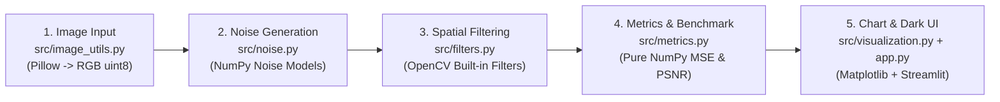

<div dir="rtl">

# دليل مذاكرة ومناقشة المشروع — Image Noise Removal Laboratory

> **المشروع:** Image Noise Removal Laboratory (معمل إزالة الضوضاء من الصور الرقمية)  
> **اللغة والتقنيات:** Python + NumPy + OpenCV + Pillow + Matplotlib + Streamlit  
> **عدد أفراد الفريق:** **4 أفراد**  
> **الغرض من الملف:** مرجع شامل بالعامية المصرية البسيطة والمحترفة عشان نذاكر منه كلنا كفريق قبل المناقشة مع الدكتورة، ونعرف نشرح كل سطر كود وكل قرار هندسي بثقة.

---

## 1. فكرة المشروع باختصار (وليه Classical مش AI؟)

### فكرة المشروع إيه؟
إحنا عملنا تطبيق ويب تفاعلي (Interactive Laboratory) شبه برامج معالجة الصور الحقيقية، بيخلي المستخدم:
1. يرفع صورة نظيفة (Clean Image) أو يختار صورة جاهزة من عينات المشروع (`sample_images/`).
2. يضيف عليها **3 أنواع من الضوضاء الكلاسيكية (Noise)** بمستويات مختلفة (`Low` / `Medium` / `High`).
3. يجرّب عليها **4 فلاتر مكانية (Spatial Filters)** باستخدام OpenCV ويتحكم في الـ Parameters بتاعتها.
4. يقارن الصورة **الأصلية (Original)** مع **اللي فيها ضوضاء (Noisy)** مع **بعد الفلترة (Filtered)** جنب بعض بالعين، وكمان بالأرقام باستخدام **MSE** و **PSNR**.
5. يدخل على صفحة **Filter Comparison** اللي بتشغل الـ 4 فلاتر مرة واحدة على نفس الصورة، وترسم Chart وتقوله علمياً أنهي فلتر كسب وليه.

### ليه استخدمنا Classical Image Processing مش AI / Deep Learning؟
لو الدكتورة سألت السؤال ده، الإجابة المباشرة والمقنعة هي:
1. **هدف الكورس والأكاديميا:** المشروع بيوضح الأساس الرياضي والفيزيائي للـ **Spatial Domain Filtering** (إزاي كل فلتر بيتعامل مع البكسلات المجاورة له) مش مجرد Black-Box Neural Network.
2. **السرعة وخفة التشغيل:** الفلاتر الكلاسيكية في OpenCV بتشتغل في أجزاء من الثانية على أي لابتوب عادي من غير GPU ولا Training ولا Datasets ضخمة.
3. **الشفافية وسهولة التفسير (Interpretability):** نقدر نشرح بدقة *ليه* الـ Median Filter بيمسح الـ Salt-and-Pepper، و*ليه* الـ Bilateral Filter بيحافظ على الحواف (Edges).
4. **استخدام الـ Kaggle Dataset بذكاء:** بدل ما نحمّل جيجات من dataset الـ GANs، أخدنا منها عينة صغيرة (5–8 صور نظيفة) كـ **Ground Truth** عشان نولّد عليها الـ Noise بنفسنا ونحسب الـ PSNR بدقة 100%.

---

## 2. رحلة الصورة جوا المشروع (The Pipeline)

كل مرحلة في الكود مفصولة في Module مستقل جوا مجلد `src/`، وبتسلّم النتيجة للمرحلة اللي بعدها عن طريق `st.session_state` في `app.py`:

<div dir="ltr">



</div>

### هيكل ملفات المشروع

<div dir="ltr">

```text
Image_Noise_Removal/
├── .streamlit/config.toml    # إعدادات الـ Dark Theme
├── assets/styles.css         # تنسيق الكروت والأزرار والـ Spacing
├── sample_images/            # 5-8 صور نظيفة من Kaggle Dataset
├── src/
│   ├── image_utils.py        # التحقق من الصور وتحويلها لـ RGB uint8
│   ├── noise.py              # توليد Gaussian, Salt-and-Pepper, Speckle
│   ├── filters.py            # فلاتر Average, Gaussian, Median, Bilateral
│   ├── metrics.py            # حساب MSE و PSNR ومقارنة كل الفلاتر
│   └── visualization.py      # رسم Bar Chart للـ PSNR بـ Matplotlib
├── app.py                    # واجهة Streamlit (4 صفحات + Session State)
└── requirements.txt          # الـ 5 مكتبات الأساسية
```

</div>

---

## 3. شرح كل الملفات والـ Functions (والترِكات اللي الدكتورة بتسأل فيها)

### أولاً: `src/image_utils.py` — استقبال الصور والتحقق منها
ده خط الدفاع الأول للمشروع؛ وظيفته يتأكد إن أي صورة داخلة سليمة ويوحّد شكلها قبل أي معالجة.

| الدالة (Function) | بتاخد إيه (Parameters) | بتعمل إيه بالظبط؟ |
| :--- | :--- | :--- |
| `_decode_image_bytes` | `raw_bytes`, `filename` | بتتحقق من الامتداد (`.jpg/.jpeg/.png`)، بتفحص سلامة الملف بـ `Pillow`، بتحول الصورة لـ `RGB`، بتتأكد إنها مش أصغر من `16×16`، وبتصغّرها لو أكبر من `1600 px`. |
| `load_and_validate_image` | `uploaded_file` | بتستقبل الملف اللي المستخدم رفعه في Streamlit وتبعته لـ `_decode_image_bytes`. |
| `list_sample_images` | `folder` | بتقرأ الصور الصالحة الموجودة في `sample_images/` مترتبة أبجدياً. |
| `load_sample_image` | `image_path` | بتقرأ صورة من `sample_images/` بنفس خطوات التحقق. |
| `get_image_info` | `image`, `filename`, `image_format`, `original_mode`, `was_resized` | بترجع Dictionary فيه العرض والطول وعدد القنوات والـ Format عشان نعرضه في الـ UI. |
| `resize_for_display` | `image`, `max_width=720` | بتصغّر نسخة العرض فقط في الواجهة عشان الصور تبقى متناسقة وسريعة من غير ما تلمس الصورة الأصلية بتاعة المعالجة. |

**تريكات مهمة الدكتورة ممكن تسأل فيها هنا:**
- **ليه عملنا `check_img.verify()` وبعدين فتحنا الصورة تاني بـ `Image.open`؟**  
  لأن `verify()` في Pillow بتفحص إن الملف صورة حقيقية ومش ملف Text متغير اسمه لـ `.jpg`، وبعدها بتقفل/تستهلك الـ stream، فلازم نفتح الصورة من جديد عشان نقرأ البكسلات.
- **ليه بنحول كل الصور بـ `img.convert("RGB")`؟**  
  لأن المستخدم ممكن يرفع صورة أبيض وأسود (1 Channel `L`) أو PNG فيها خلفية شفافة (4 Channels `RGBA`). لما نوحّدهم كلهم لـ **3-Channel RGB `uint8`** بنضمن إن كل دوال الـ Noise والـ Filters والـ MSE تشتغل من غير أي Crash في الـ dimensions.
- **ليه في OpenCV محوّلناش من `RGB` لـ `BGR` قبل الفلترة؟**  
  سؤال ذكي جداً! OpenCV فعلاً بيقرأ الصور `BGR` لو استخدمنا `cv2.imread`، بس إحنا قرأنا الصور بـ **Pillow (`RGB`)** وعرضناها في **Streamlit (`RGB`)**. والأهم إن الـ 4 فلاتر المكانية اللي استخدمناها (`blur`, `GaussianBlur`, `medianBlur`, `bilateralFilter`) **Channel-Symmetric** — يعني بيعاملوا كل قناة لوحدها أو بمسافة إقليدية متماثلة، فترتيب `RGB` بيفضل سليم 100% ومفيش أي لون بيتقلب!

---

### ثانياً: `src/noise.py` — توليد الضوضاء بـ NumPy
فيها 3 أنواع ضوضاء بـ 3 مستويات (`Low` / `Medium` / `High`) متخزنين في `NOISE_PRESETS`:

| الدالة (Function) | المعادلة / الفكرة | قيم الـ Presets (`Low` / `Med` / `High`) |
| :--- | :--- | :--- |
| `add_gaussian_noise` | `clip(img + N(0, σ), 0, 255)` | `σ = 15` / `35` / `60` |
| `add_salt_and_pepper_noise` | استبدال نسبة عشوائية من البكسلات بـ `255` (ملح) و `0` (فلفل) | `2%` / `6%` / `15%` من البكسلات |
| `add_speckle_noise` | `clip(img + img * N(0, σ), 0, 255)` | `σ = 0.15` / `0.35` / `0.60` |
| `apply_noise` | Dispatcher بيختار الدالة المناسبة حسب اسم الـ Noise | — |
| `get_noise_parameter_label` | بترجع نص مقروء للواجهة زي `σ = 35` أو `6% corrupted pixels` | — |

**تريكات مهمة الدكتورة ممكن تسأل فيها هنا:**
- **ليه حولنا الصورة لـ `float32` قبل ما نجمع الـ Gaussian أو Speckle Noise، وبعدين عملنا `np.clip(0, 255)`؟**  
  لأن الصورة الأصلية نوعها `uint8` (أرقام من 0 لـ 255 فقط). لو جمعنا عليها رقم وطلع `270` أو طرحنا وطلع `-10` وهي `uint8` هيحصل **Wrap-Around Overflow** (مثلاً `-10` تتحول فجأة لـ `246` أبيض!). فالحل الصح نحول `float32`، نجمع، نقص الأطراف بـ `np.clip(0, 255)`، وبعدين نرجّعها `uint8`.
- **ليه في `add_salt_and_pepper_noise` عملنا `random_map` ثنائي الأبعاد `(height, width)` مش ثلاثي `(height, width, 3)`؟**  
  عشان لما بكسل يتصاب بالـ Salt تبقى كل قنواته `(255, 255, 255)` فيظهر **أبيض صافي**، والـ Pepper يبقى `(0, 0, 0)` **أسود صافي**. لو كانت 3D كانت هتطلع نقط حمراء وخضراء وزرقاء (Impulse ملون مش Salt-and-Pepper كلاسيكي).
- **إيه الفرق الجوهري بين Gaussian و Speckle؟**  
  الـ Gaussian **Additive** (بيضاف بالتساوي على الغامق والفاتح)، أما الـ Speckle **Multiplicative** (مضروب في قيمة البكسل `img * gauss`، فبيظهر أقوى في المناطق الفاتحة وشائع في صور الـ Radar والـ Ultrasound).

---

### ثالثاً: `src/filters.py` — الفلاتر المكانية بـ OpenCV
استخدمنا دوال OpenCV الجاهزة والسريعة جداً (C++ تحت الغطاء):

| الدالة (Function) | دالة OpenCV | الـ Parameters | بتشتغل إزاي؟ |
| :--- | :--- | :--- | :--- |
| `apply_average_filter` | `cv2.blur` | `kernel_size` (`3,5,7,9`) | بتاخد المتوسط الحسابي البسيط لكل البكسلات جوا المربع `k×k`. |
| `apply_gaussian_filter` | `cv2.GaussianBlur` | `kernel_size`, `sigma` (`0=auto`) | متوسط موزون (Bell-curve) بيدي وزن أكبر للبكسلات القريبة من المركز، فالتنعيم بيبقى أنعم من الـ Average. |
| `apply_median_filter` | `cv2.medianBlur` | `kernel_size` (`3,5,7,9`) | **فلتر غير خطي (Non-linear):** بيرتب قيم البكسلات جوا النافذة وياخد القيمة اللي في النص (الوسيط). |
| `apply_bilateral_filter` | `cv2.bilateralFilter` | `diameter`, `sigma_color`, `sigma_space` | **فلتر حافظ للحواف (Edge-Preserving):** بيوزن البكسلات بحاجتين مع بعض: قرب المكان (`sigmaSpace`) وتشابه اللون (`sigmaColor`). |
| `_validate_odd_kernel` | — | `kernel_size` | بتضمن إن الـ Kernel دايماً رقم فردي `>= 3` عشان OpenCV ميعملش Error. |

**تريكات مهمة الدكتورة ممكن تسأل فيها هنا:**
- **ليه الـ `kernel_size` لازم يكون رقم فردي (`3, 5, 7, 9`)؟**  
  لأن الفلتر المكاني عبارة عن نافذة (Sliding Window) بتتمركز فوق بكسل واحد بنحسب قيمته الجديدة. المربع الفردي فقط (مثلاً `3×3` أو `5×5`) هو اللي له **بكسل مركزي واحد بالظبط** في النص وحواليه عدد متساوي من الجيران يمين وشمال وفوق وتحت.
- **ليه الـ Median Filter هو الملك في الـ Salt-and-Pepper Noise؟**  
  لأن الـ Salt (`255`) والـ Pepper (`0`) عبارة عن قيم متطرفة (Outliers). لما ترتب 9 بكسلات في نافذة `3×3`، الـ `0` بيروح أول القائمة والـ `255` بيروح آخرها، فالقيمة اللي في النص (**الوسيط**) بتطلع بكسل طبيعي من الصورة الأصلية، وبكده النقطة بتختفي تماماً من غير ما تتسيّح! بعكس الـ Average اللي بيجمع الـ `255` ويقسمها فيعمل بقعة رمادي.
- **ليه ضفنا الـ Bilateral Filter كـ "فلتر إضافي" وإزاي بيحافظ على الحواف؟**  
  لو في حافة حادة بين جسم أبيض وخلفية سوداء، الـ Average والـ Gaussian بيخلطوا الأبيض مع الأسود فيسيّحوا الحافة. أما الـ **Bilateral Filter** بيستخدم `sigmaColor` فيلاقي إن الفرق اللوني كبير جداً بين الأبيض والأسود، فيديهم وزن شبه صفر وميخلطهمش ببعض—فينعّم الضوضاء في المناطق المتشابهة ويسيب الحافة حادة!

---

### رابعاً: `src/metrics.py` و `src/visualization.py` و `app.py` — التقييم والرسومات والواجهة
- **`calculate_mse` & `calculate_psnr` (`src/metrics.py`):**
  - بنحسب **MSE** بـ `float64` (عشان لو طرحنا `uint8` هيحصل Underflow):
    $$\text{MSE} = \frac{1}{N}\sum(I_{\text{orig}} - I_{\text{proc}})^2$$
    كل ما يقل يبقى أحسن (`0` = تطابق تام).
  - بنحسب **PSNR** بالديسيبل (dB):
    $$\text{PSNR} = 20 \cdot \log_{10}\left(\frac{255}{\sqrt{\text{MSE}}}\right)$$
    كل ما يعلى يبقى أحسن (عادة الصور الكويسة بين 25 و 40 dB). ولو `MSE == 0` بنرجّع `float("inf")` وتتعرض `∞ dB` عشان مفيش قسمة على صفر!
- **`evaluate_all_filters` (`src/metrics.py`):** بتشغل الـ 4 فلاتر على نفس الصورة الـ Noisy بنفس الـ `kernel_size` عشان المقارنة تبقى عادلة، وتختار الفايز بناءً على أقل MSE (أعلى PSNR).
- **`plot_psnr_comparison` (`src/visualization.py`):** بترسم Bar Chart متناسق مع الـ Dark Theme (`#131926`)، وتلوّن الفلتر الفايز بالأخضر (`#10B981`)، وترسم خط متقطع أصفر للـ Noisy Baseline. ولو في فلتر جاب `∞ dB` بتعمله سقف بصري عشان Matplotlib ميضربش.
- **`app.py`:**
  - بتستخدم `st.session_state` عشان الصورة الأصلية والـ Noisy والـ Filtered يفضلوا محفوظين وإنت بتتنقل بين الـ 4 صفحات (`Dashboard`, `Noise Laboratory`, `Filter Comparison`, `About Project`)، ولما ترفع صورة جديدة بتمسح النتائج القديمة تلقائياً (`set_active_image`).
  - بنقفل رسمة Matplotlib بـ `plt.close(fig)` بعد العرض عشان مفيش تسريب في الرامات (Memory Leak).

---

## 4. تقسيمة الشغل والمناقشة بالتساوي على 4 أفراد

قسّمنا المشروع لـ **4 أجزاء متكاملة ومتساوية** بحيث كل فرد يمسك مرحلة واضحة بملفاتها ويشرحها بثقة:

---

### الشخص الأول (Member 1): مقدمة المشروع، الـ Dataset، وإدخال الصور
- **الـ Phases المسئول عنها:** `Phase 0` (البيئة والـ Dataset) + `Phase 2` (رفع الصور والتحقق منها).
- **الملفات والدوال بتاعته:**
  - `requirements.txt`, `sample_images/`
  - `src/image_utils.py`: `load_and_validate_image`, `_decode_image_bytes`, `list_sample_images`, `load_sample_image`, `get_image_info`, `resize_for_display`.
- **هيشرح إيه للدكتورة؟**
  1. فكرة المشروع وليه اخترنا **Classical Image Processing** مش Deep Learning.
  2. إزاي استخدمنا عينة ذكية (5–8 صور نظيفة) من Kaggle Dataset كـ Ground Truth بدل تحميل جيجات بدون داعي.
  3. إزاي بنستقبل الصورة (Upload أو Sample)، بنتأكد إنها سليمة بـ Pillow (`verify()`), بنوحّدها لـ `RGB uint8`، وبنتعامل مع الـ Edge Cases (صور تالفة، Grayscale، RGBA، صور ضخمة > 1600px أو صغيرة < 16px).
- **أسئلة الدكتورة المتوقعة وإجاباتها:**
  - **س: لو حد غيّر امتداد ملف `.txt` خلاه `.jpg` ورفعه، البرنامج هيقع؟**  
    **ج:** لأ يا دكتورة، لأننا بنعمل فحصين في `_decode_image_bytes`: الأول بنفحص الامتداد، والتاني بننادي `Image.verify()` من Pillow، فبيكتشف فوراً إن الملف مش صورة حقيقية ويطلع رسالة خطأ لطيفة للمستخدم من غير Crash.
  - **س: ليه حولتوا كل الصور لـ RGB؟ طب لو الصورة Grayscale؟**  
    **ج:** لو الصورة Grayscale بتبقى 2D (قناة واحدة)، ولو PNG شفافة بتبقى 4 قنوات. لما نحولها لـ `RGB` بـ `convert("RGB")` بتفضل شكلها أبيض وأسود عادي لكن أبعادها ثابتة `(H, W, 3)` فكل دوال الـ Noise والـ Filters والـ MSE تشتغل عليها بسلاسة.
  - **س: ليه استخدمتوا Pillow لفتح الصورة مع إن OpenCV فيه `cv2.imread`؟**  
    **ج:** لأن الملف في Streamlit بيجي كـ Bytes في الرامات مش مسار على الهارد، و Pillow ممتازة في فحص سلامة الـ Bytes بـ `verify()` وبتدينا الصورة `RGB` جاهزة للعرض مباشرة.

---

### الشخص الثاني (Member 2): نماذج توليد الضوضاء (Noise Generation)
- **الـ Phase المسئول عنها:** `Phase 3` (توليد الضوضاء).
- **الملفات والدوال بتاعته:**
  - `src/noise.py`: `NOISE_PRESETS`, `add_gaussian_noise`, `add_salt_and_pepper_noise`, `add_speckle_noise`, `apply_noise`, `get_noise_parameter_label`.
- **هيشرح إيه للدكتورة؟**
  1. الفارق العلمي بين الـ 3 أنواع: **Gaussian** (Additive)، **Salt-and-Pepper** (Impulse)، و **Speckle** (Multiplicative).
  2. إزاي برمجنا كل نوع بـ **NumPy** فقط وبـ 3 مستويات (`Low`, `Medium`, `High`) مضبوطة في `NOISE_PRESETS`.
  3. فكرة التحويل لـ `float32` والـ `np.clip(0, 255)` عشان نمنع الـ Overflow.
- **أسئلة الدكتورة المتوقعة وإجاباتها:**
  - **س: ليه محسبتوش الـ Gaussian Noise على الصورة وهي `uint8` مباشرة؟**  
    **ج:** لأن `uint8` آخرها من 0 لـ 255؛ لو بكسل قيمته 250 وزودنا عليه +20 في `uint8` بيلف ويرجع 14 (أسود!)، ولو بكسل 5 وطرحنا منه 15 بيلف ويبقى 246 (أبيض!). فبنحول لـ `float32`، نجمع، نعمل `np.clip(0, 255)`، وبعدين نرجّعها `uint8`.
  - **س: إيه الفرق بين Salt-and-Pepper والـ Gaussian؟**  
    **ج:** الـ Gaussian بيغير قيمة **كل** بكسلات الصورة بمقدار عشوائي صغير حوالين الصفر (توزيع طبيعي)، أما الـ Salt-and-Pepper بيصيب **نسبة صغيرة** فقط من البكسلات (`2%` لـ `15%`) بس بيحولها لقيم متطرفة تماماً: أبيض صافي `255` أو أسود صافي `0`.
  - **س: ليه الـ Speckle Noise بيبان أوضح في المناطق الفاتحة في الصورة؟**  
    **ج:** لأنه ضوضاء ضربية (Multiplicative): `noisy = img + img * gauss`. فكل ما قيمة البكسل `img` تبقى أكبر (أفتح)، مقدار التشويش المضروب فيه بيبقى أكبر.

---

### الشخص الثالث (Member 3): الفلاتر المكانية (Spatial Filtering)
- **الـ Phase المسئول عنها:** `Phase 4` (الفلاتر المكانية).
- **الملفات والدوال بتاعته:**
  - `src/filters.py`: `apply_average_filter`, `apply_gaussian_filter`, `apply_median_filter`, `apply_bilateral_filter`, `_validate_odd_kernel`, `format_filter_params`, `apply_filter`.
- **هيشرح إيه للدكتورة؟**
  1. الفرق بين الـ **Linear Filters** (`Average` و `Gaussian`) والـ **Non-Linear Filter** (`Median`).
  2. ليه الـ `kernel_size` لازم يكون فردي (`3, 5, 7, 9`)، وتأثير تكبير الـ Kernel (تنعيم أكتر بس تفاصيل أقل / Blur أكتر).
  3. ليه اخترنا الـ **Bilateral Filter** كـ "فلتر إضافي" (Edge-Preserving) وإزاي بيفرق عن الـ Gaussian العادي.
- **أسئلة الدكتورة المتوقعة وإجاباتها:**
  - **س: ليه الـ Kernel لازم يكون رقم فردي؟**  
    **ج:** عشان النافذة يكون لها **بكسل واحد بالظبط في المركز** (اللي بنبدّل قيمته)، ويبقى حواليه عدد متماثل من الجيران من كل ناحية. الرقم الزوجي ملهوش مركز حقيقي.
  - **س: ليه الـ Average Filter بيفشل مع الـ Salt-and-Pepper؟**  
    **ج:** لأنه بيحسب المتوسط الحسابي، فلما يلاقي بكسل `255` أو `0` بيدخله في الحسبة ويوزع تأثيره على الجيران، فالنقطة بدل ما تختفي بتتسيّح وتعمل بقعة رمادي. أما الـ **Median** بياخد القيمة الوسطى فبيرمي الـ `0` والـ `255` بره الحسبة خالص.
  - **س: إيه فايدة `sigma = 0` في `cv2.GaussianBlur`؟**  
    **ج:** لما نبعت `sigmaX = 0` لـ OpenCV، هو بيحسب قيمة الـ Sigma المثالية أوتوماتيك من مقاس الـ `kernel_size`، وده مريح للمستخدم، ومع ذلك سيبناله Slider لو حب يتحكم فيها بنفسه.
  - **س: إيه الفرق بين `sigmaSpace` و `sigmaColor` في الـ Bilateral Filter؟**  
    **ج:** `sigmaSpace` بتتحكم في مدى تأثير البكسلات **القريبة مكانياً** (زي الـ Gaussian العادي)، أما `sigmaColor` بتتحكم في مدى السماح بخلط الألوان **المختلفة**. فلو في حافة لونها مختلف جداً، `sigmaColor` بتمنع الخلط فتحافظ على الحافة حادة!

---

### الشخص الرابع (Member 4): قياس الجودة، المقارنة الشاملة، والـ UI
- **الـ Phases المسئول عنها:** `Phase 1` (الواجهة الداكنة) + `Phase 5` (المقارنة والـ Metrics) + `Phase 6` (صفحة المقارنة والـ Chart) + `Phase 7` (التكامل والـ README).
- **الملفات والدوال بتاعته:**
  - `src/metrics.py`: `calculate_mse`, `calculate_psnr`, `format_psnr`, `evaluate_single_experiment`, `evaluate_all_filters`, `get_noise_filter_insight`.
  - `src/visualization.py`: `plot_psnr_comparison`.
  - `app.py`, `.streamlit/config.toml`, `assets/styles.css`, `README.md`.
- **هيشرح إيه للدكتورة؟**
  1. إزاي بنقيّم الفلاتر **بالأرقام مش بالعين بس** باستخدام **MSE** و **PSNR** (Pure NumPy).
  2. إزاي صفحة **Filter Comparison** بتشغل الـ 4 فلاتر مرة واحدة وتعرض Grid من 6 صور + جدول مقارنات + Bar Chart بـ Matplotlib + استنتاج علمي أوتوماتيك.
  3. هندسة الواجهة في `app.py` (الـ Dark Theme، تقسيمة الـ 4 صفحات، وإدارة الـ `st.session_state`).
- **أسئلة الدكتورة المتوقعة وإجاباتها:**
  - **س: إيه العلاقة بين MSE و PSNR؟ ومين فيهم أحسن لما يزيد؟**  
    **ج:** علاقة عكسية لوغاريتمية. الـ **MSE** هو متوسط مربع الخطأ فكل ما **يقل** يبقى أحسن (`0` يعني تطابق تام). الـ **PSNR** بيتحسب من `20 * log10(255 / sqrt(MSE))` فكل ما **يزيد** بالديسيبل (dB) تبقى الصورة أقرب للأصل.
  - **س: هيحصل إيه في الكود لو الصورة بعد الفلترة طلعت مطابقة للأصل (`MSE = 0`)؟ هيحصل Divide by Zero؟**  
    **ج:** لأ يا دكتورة، إحنا عاملين Guard في `calculate_psnr`: لو `mse == 0.0` بترجع `float("inf")` وبتتعرض `∞ dB` في الـ UI، وكمان في `plot_psnr_comparison` عاملين سقف بصري للعمود عشان Matplotlib ميحصلش فيه Error.
  - **س: ليه استخدمتوا `st.session_state` في Streamlit؟**  
    **ج:** لأن Streamlit بيعيد تشغيل ملف `app.py` من الأول مع كل ضغطة زرار. من غير `st.session_state` الصورة الأصلية والـ Noisy كانوا هيتمسحوا أول ما نضغط "Apply Filter" أو نروح صفحة "Filter Comparison". فخزّناهم في الـ `session_state`، وبنمسحهم أوتوماتيك في `set_active_image` لما المستخدم يغير الصورة عشان مفيش نتائج قديمة تظهر على صورة جديدة.

---

## 5. سيناريو العرض العملي قدام الدكتورة (Live Demo في 4 دقايق)

عشان المناقشة تطلع منظمة جداً وتبهر الدكتورة، امشوا بالترتيب ده:

1. **الشخص الأول (دقيقة):** يفتح **Dashboard**، يشرح فكرة المشروع بسرعة، يدخل **Noise Laboratory**، ويرفع صورة نظيفة (أو يختار Sample) ويورّي الدكتورة الـ Resolution والـ Validation.
2. **الشخص الثاني (دقيقة):** يختار **Salt-and-Pepper Noise (Medium)** ويضغط **Apply Noise**، ويورّي الدكتورة الصورة الأصلية جنب الـ Noisy ويشرح النقط البيضاء والسوداء.
3. **الشخص الثالث (دقيقة):** يجرّب الأول **Average Filter (`5×5`)** عشان يورّي الدكتورة إنه سيّح الصورة ومشالش النقط كويس، وبعدين يغيّره لـ **Median Filter (`3×3`)** ويضغط **Apply Filter** عشان تشوف النتيجة النظيفة جداً.
4. **الشخص الرابع (دقيقة):** يورّيها الـ **3-Way Comparison** وارتفاع الـ **PSNR**، وبعدين يروح لصفحة **Filter Comparison** ويورّيها الـ 6 صور والـ Table والـ **PSNR Bar Chart** (والـ Median كسبان بالأخضر)، وبعدها يرجع يغيّر الـ Noise لـ **Gaussian Noise** ويورّيها إن ترتيب الفلاتر الفايزة اتغير—وبكده تكونوا أثبتّوا الهدف الأكاديمي الأساسي للمشروع عملياً قدامها!

</div>
